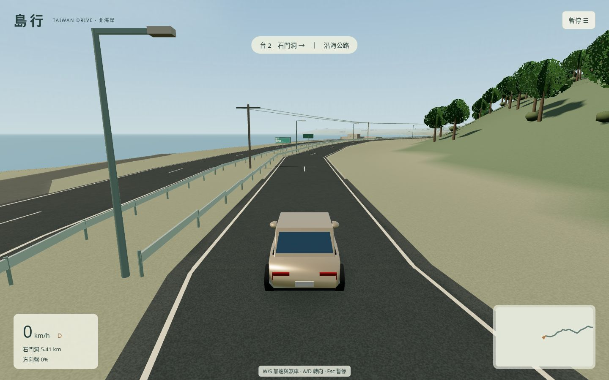
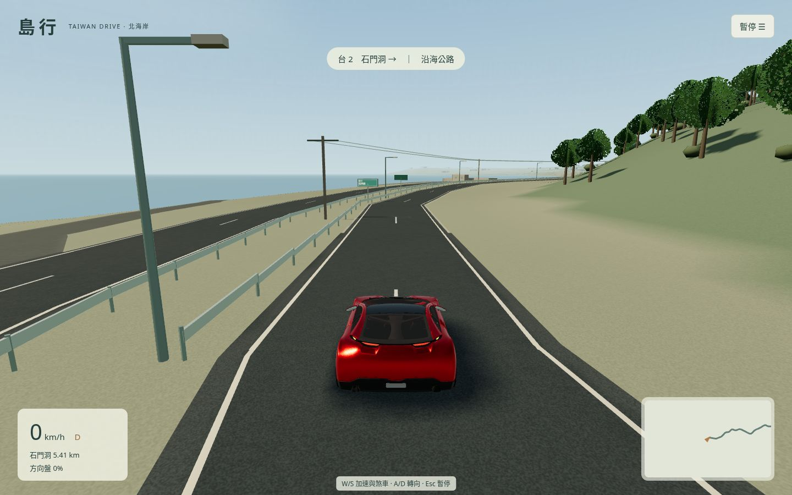
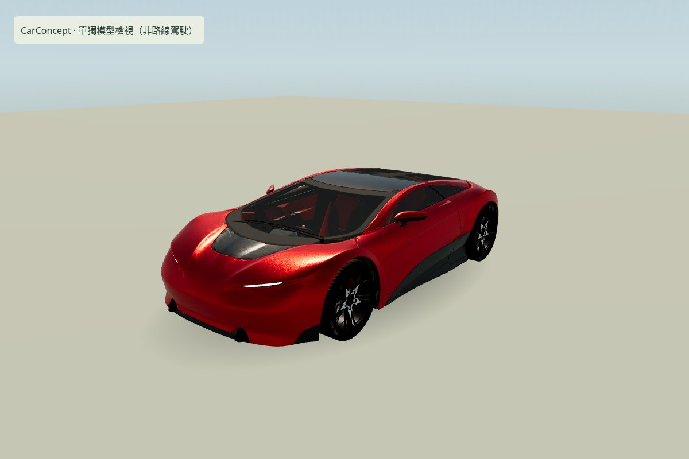
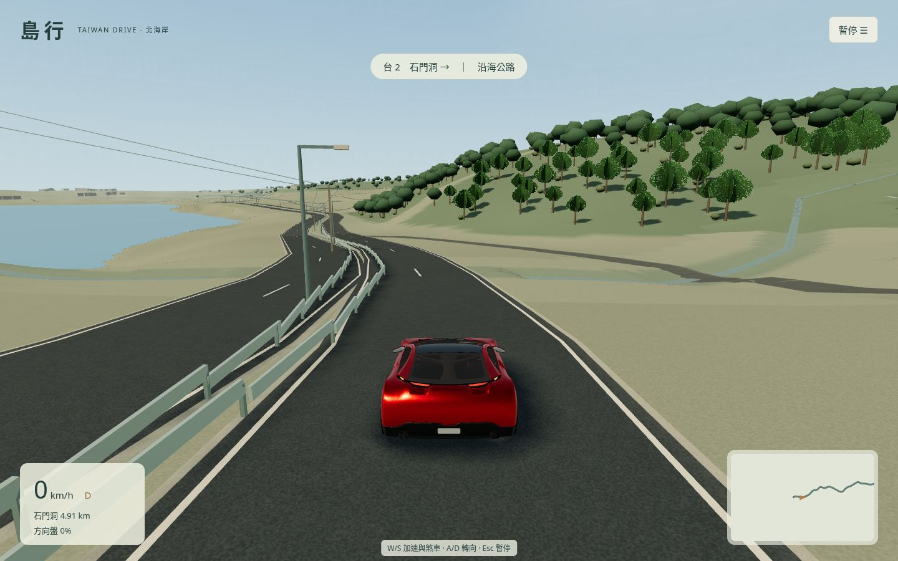
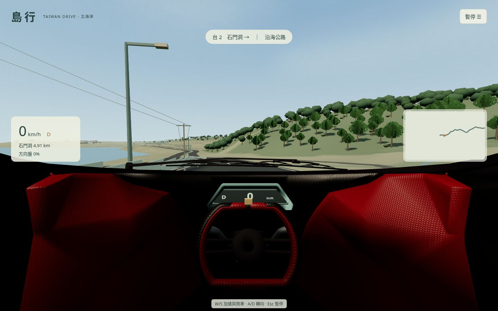
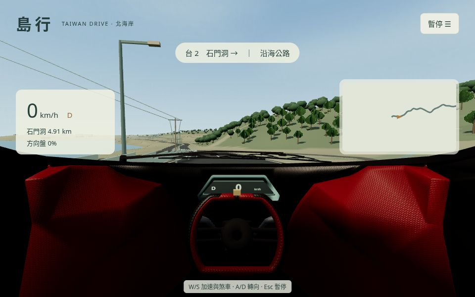

# 免費高精度車輛試裝

本輪接入 **CarConcept 概念跑車及其完整3D內飾**，選單「車輛外觀」可切回原創轎車。這是虛構車款的美術試裝；沒有修改道路、地圖、車輛物理或駕駛輸入。樹木、建築、岩石及設施仍使用原有程序模型，未接入其他外部資產。

## 來源、許可與實際處理

- 作者 Eric Chadwick / Darmstadt Graphics Group GmbH（2024）；模型及貼圖 CC BY 4.0。來源固定至 Khronos glTF-Sample-Assets 的 `15cd02d304e54cb42a4db4eefe719f76190f4b68`，真實 GET 後核對 SHA256。上游 Khronos 標識另有條款，已移除標識車牌貼圖與方向盤徽標。
- 原始 GLB 11,778,688 bytes，SHA256 `c272098089d78c5cd9fd9f24ff50ee8acf8d932c55f2d55fc10adb6c8998966b`；遊戲 GLB 5,631,824 bytes，SHA256 `430709bcdaf690d07f2dad9b37c482666bfcdac0c819b786dd73c14b61ee5140`。
- 處理後111,549三角形、10個網格組／44個繪製primitive、23種材質。貼圖內嵌WebP、最高1024，無外部貼圖請求。glTF Validator實際檢查0錯誤、0警告。固定來源、每張貼圖及部件清單見 [carconcept.json](../source-data/carconcept.json)。
- 按實際頂點接地並居中，Y-up、+Z前進；移除原始前輪展示轉角，四輪分離打輪／滾動／固定卡鉗，方向盤校正中性姿態。原創即時速度／擋位儀表取代原素材的固定0顯示，另加方向盤標記。簡化ratio0.5／error0.001、鎖邊；WebP quality90。
- 標準檔普通PBR，精細檔增加車漆clearcoat；透明玻璃不用額外整景透射pass。車體約4.36m長／2.54m寬／1.15m高，是寬矮概念車，並非臺灣實車重建。相機中央眼點、75度垂直FOV、視覺車高均為估算，物理軸距與碰撞模型沿用原型。
- 完整來源與改作署名在 [SOURCES](../SOURCES.md)、[許可目錄](../licenses/carconcept/)，遊戲幫助與靜態包 `credits/carconcept.txt` 亦保留署名和許可全文。`npm run assets:car` 可從鎖定來源重建，沿用環境代理及TLS驗證。處理工具是開發依賴，遊戲沒有付費API。
- Poly Haven下載網域不在目前雲端白名單，未擴大權限，未聲稱取得其樹木／建築／岩石。

## 畫面與已修問題

| 原創轎車（同起點） | 概念車試裝（同起點） |
|---|---|
|  |  |

另在隔離模型檢視器抽查正面、輪圈、車燈與車體輪廓（上圖），標準材質、1200×800／DPR1、相機(4,2.5,5)／FOV45；非遊戲駕駛證據，未修改Game或相機調試掛鉤。檢視器記錄0錯誤、凍結哈希不變。

上述靜態畫面使用嚴格校驗的存檔檢查點與真實選單，不能證明連續駕駛。另有 [全新起步實際W輸入畫面](visual/asset-cockpit-driving.jpg) 和 [320×568選單](visual/asset-menu.jpg)。截圖原始參數、車輛狀態、renderer.info與前後哈希在 [asset-checkpoints.json](asset-checkpoints.json)。窄屏僅驗證選單，未宣稱手機駕駛。

檢查曾發現眼點位於頭枕內、前進輪子滾動方向反向、動態儀表UV被清理、切換視角鏡頭穿過車身，均已修正。其後實際W加速截圖又抓到駕駛艙鏡頭因第三人稱平滑跟隨而退入座椅，改為駕駛艙相機逐幀固定在車內眼點；第三人稱保留平滑跟隨。失敗／中斷執行未計入通過數。

## 回歸驗證

最終鏡頭修正後真實執行：`npm test` **17通過**；`npm run build` **通過**（TypeScript strict，JS 666.18KB／gzip179.94KB，保留大於500KB的bundle警告）；`npx playwright test` **19通過、0失敗／跳過／flaky**，單worker，總時長493.995s。完整逐項結果將記錄於 `asset-summary.json`。

驗證範圍包括W/S加速／煞停／倒車／雙鍵煞停、A/D實際畫面轉向、放開回正、車輪與3D方向盤方向、動態儀表、行駛中眼點誤差、失焦／隱藏安全、v1存檔與無效raw保護、終點UI、桌面與320px佈局、三檔畫質，以及GLB失敗回退後仍可駕駛。正式 `/taiwan-drive/` 子路徑檢查實際GLB／地圖／本地許可、無調試掛鉤及真實W輸入。模型選擇不改動車輛狀態或v1存檔格式。

## 同條件渲染成本

最終鏡頭修正後實測如下，兩次記錄錯誤均為0、全部src/public/dist和測試腳本前後哈希一致。方法是同一試裝構建、全新BrowserContext、標準檔、1280×800、DPR1、Chromium154／SwiftShader、起點暫停相機，地圖和車輛就緒後觀察45秒。透過真實選單切換模型；兩種模型已同時載入記憶體，並非舊提交與新提交的記憶體比較。保留啟動和全部慢幀，不過濾。

| 指標 | 原創轎車 | 概念車 |
|---|---:|---:|
| 最後一幀繪製調用 | 391 | 417 |
| 最後一幀三角形 | 597,348 | 707,097 |
| 原始幀數 | 59 | 51 |
| 幀間隔中位 | 750ms | 900ms |
| 幀間隔p95 | 1516.6ms | 1666.6ms |
| 最大幀間隔（含啟動） | 8852.7ms | 9522.4ms |

概念車增加26次繪製調用／109,749個提交三角形，雲端軟體渲染的幀間隔中位增加20%。這是有限條件下的兩次觀察，不能推算普通筆電FPS或宣稱流暢。

原始資料見 [原車](perf-asset-original.json)／[概念車](perf-asset-concept.json)。View建構時間不含車輛下載／解碼；readyMs包含下載／解碼／第一次模型渲染。原車／概念車的JS render中位4.7／8.7ms，p95 26.1／23.6ms；readyMs 9634／10252，末幀同為440個geometry／29個texture（兩車皆已載入）。JS render牆鐘時間不是非同步GPU時間；這裡的幀間隔不能當作玩家FPS。概念車有更多幾何與材質，標準檔材質亦按各模型現有實作比較，沒有假稱完全相同材質。

## 全新存檔連續片段

畫面已實際查看。現在以凍結的src/public/dist執行穿越首500m及過渡段的鍵盤片段，結果待完成後追加。測試端只透過唯讀snapshot追蹤路線、產生真實page.keyboard輸入和普通選單操作，無匯入／瞬移／Game狀態寫入，沒有生產自動駕駛。目標1200m附近煞停、Esc暫停及刷新恢復；此片段不聲稱完成5.41km旅程。

本輪未重跑5.41／5.43km兩向整趟。歷史`0ea9546`整趟及使用者「基本順暢」回報屬於原創轎車舊版，不能套用到新增概念車。普通筆電實際效能、人類長時間手感、新車全線車體與路緣接觸仍待實玩；地圖、環境模型與原型碰撞仍有明確精度限制。這次只證明單一免費資產可落地，沒有達到成熟駕駛遊戲的整體資產品質。
