# 接地、前進畫面與環境質感修整

本輪針對「車像浮著、前進一卡一卡、周邊也缺質感」修整，沿用`e06ac44`的地圖與單軌車輛物理。**world.json、兩向路線、DEM和核心物理參數未改**。不以軟體渲染的測試數字宣稱使用者電腦已流暢，整體仍是早期原型。

## 改動與證據

- 原本車身只放在物理高度加固定偏移，車輪沒有對齊實際瀝青面。現在以同一組道路三角形採樣四輪支撐面，擬合可視車身俯仰／側傾，小幅輪位修整最多8cm，新增輪胎接觸陰影。只改外觀支撐，沒有修改Game位置、速度、方向或偷偷沿路行駛。
- 固定1/60s物理保留，畫面改為前後物理狀態之間插值，包含最短角度的方向與方向盤；約增加一個固定步長的顯示延遲。這處理幀率與物理更新不同步的跳格，不會產生缺少的GPU幀，也不會加快時間掩蓋慢幀。暫停、匯入、重開時重置顯示狀態；遠距返程切換直接重置鏡頭。
- 樹冠統一為原創葉簇貼圖的穩定實例化交叉面，帶枝葉、色差與體積光照估算，移除前進每24m時的整組LOD替換／矩陣與包圍球重建。既有OSM林地內的樹木／灌木XY、數量、尺寸上限及排除條件保留，未知地塊沒有新增樹木或建物。仍為近似樹冠，並非真實樹種掃描模型。
- 山坡增加依坡面與尺度變化的原創色調、土石／草屑細節。瀝青使用512²原創骨料材質、細微邊緣風化；沒有用照片冒充現地路面。護欄改為真實截面的原創W形波梁、相鄰共用端部輪廓、底板及反光片；位置與尺寸仍是場景估算，沿用已有來源的缺口規則。
- 最終保留原4m／溪溝1m地形網格及高度查詢。曾試做自適應格子合併，但全區密集審計否決了該候選（見下）；未把它放進遊戲。山體此次僅改色調與材質，沒有降低地形解析度或壓平DEM。
- 近距離側視發現舊車輪胎側壁仍含上游字樣：此前只去除了車牌／方向盤標識，已補去輪胎側壁顏色及法線圖，改用無字樣粗糙橡膠。新GLB **5,530,408 bytes**、SHA256 `788e856fdf6e4976fde2c55973cba2162044b0e001d61145bc175696d7e73a44`，111,549三角形、11張內嵌貼圖。CC BY署名及許可保留，原來源SHA不變；舊試裝報告／圖片屬歷史版本。

## 對照畫面

同一來源座標、標準檔、1280×800／DPR1、Chromium154／SwiftShader；固定View檢視器，**不是Game連續駕駛或現場照片**。前後來源哈希與數值在 [before](comfort-before-checkpoints.json)／[after](comfort-after-checkpoints.json)。已在最終凍結版本重新擷取並實際查看。

| 修正前 | 修正後 |
|---|---|
| 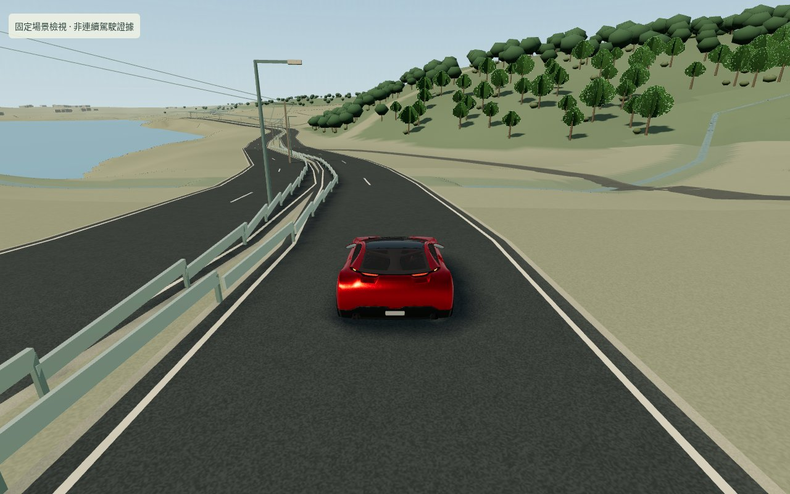 | 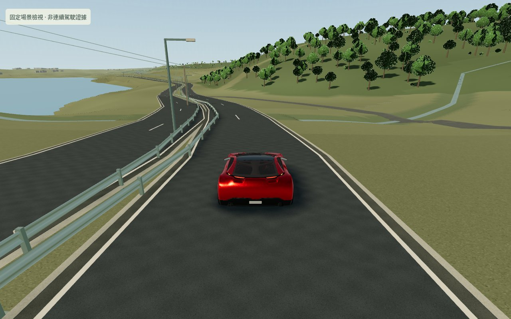 |
| 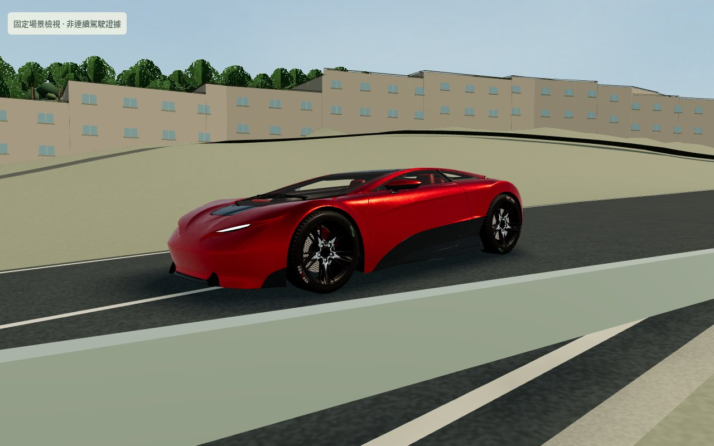 | 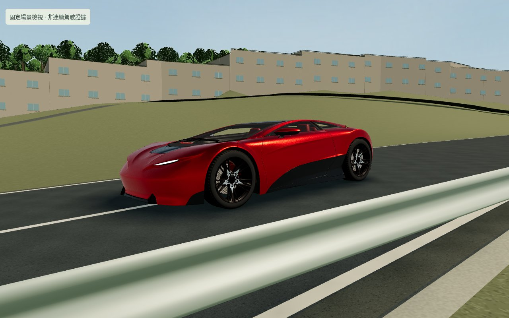 |
| 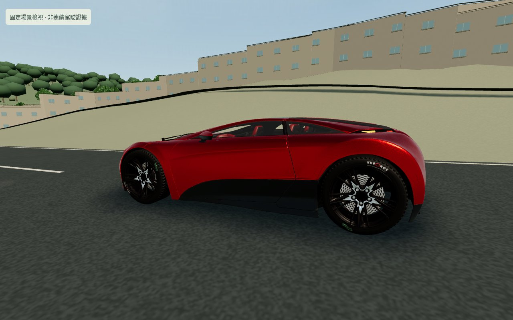 | 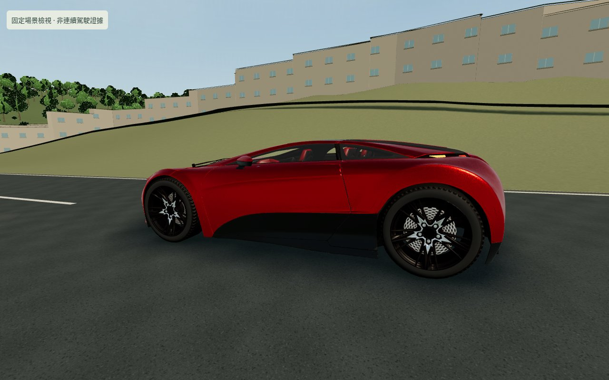 |

護欄截面可看第一行遠景與第二行前景。第三行是後側接地；檔名`rail`為早期機位命名，該畫面沒有覆蓋護欄，不作護欄近景證據。

## 接地與地形核驗

兩向2323個內部路線姿態、9292個輪胎參考接點：原最大離面約5.156cm／p95約1.853cm，修正後最大約0.00000545m、p95約0.000000052m，最大可視輪位修整約1.68mm。[原始審計](comfort-contact-audit.json)。這是來源輪心／半徑與渲染三角面的數學參考點核驗，**不是實車精度、逐胎網格射線、完整懸吊或剛體碰撞證據**。另以真實鍵盤輸入驗證兩向、兩種車的移動接地及顯示狀態重置。

自適應候選的3cm門檻只是合併候選格子的9點高度場採樣，不能保證與舊網格處處一致。對整個1800×1300m DETAIL區以4m網格偏移2m抽查146,250點，無缺樣，但溪溝20m內最大差值 **8.99286m**，全區p95 0.00704m、溪溝外最大0.04194m。這種局部極值不可接受，故**撤回該候選，最終完全保留舊地形網格與Ground高度方法**，不以低p95掩蓋。保留 [否決審計](comfort-terrain-rejected.json)、[候選算法](../scripts/research/adaptive-terrain-rejected.ts) 及 [可重跑的獨立審計](../scripts/research/audit-terrain-rejected.mjs)，它們未被Game引用或打包。

## 渲染診斷

基線為`e06ac44`加唯讀診斷／等價路面採樣器，沒有新接地、插值或新環境材質。新舊各以全新存檔、1280×800／DPR1、標準檔、同一Chromium154／SwiftShader、實際鍵盤追蹤、真實90秒預算採樣，無匯入／瞬移／Game寫入。保留全部慢幀與啟動幀，執行期間各自src/public/dist／實際driver哈希不變；不同實際距離如實報告，不能當同一精確視點的GPU比較。

基線樹木LOD的JS最高約1.6ms，不能單憑此說它是使用者卡頓主因。renderer.info不含所有陰影pass，因此另用測試端WebGL draw／rAF觀察實際提交：基線全部pass三角形中位約71.8萬，刷新陰影時可超過112萬三角形。完整原始數據與時間將在最終表格列出，JS牆鐘不是非同步GPU時間。

被否決地形候選的第一個草案實測：幀間隔中位966.6ms、p95 1283.4ms；全部pass三角形中位603,002、最大945,095。[第一個草案全部原始幀](rolling-after-first.json) 及 [字樣／光照修正後候選全部原始幀](rolling-rejected-final.json) 保留，均為歷史候選，不能作最終版本數字。最終版本保留原地形網格後重取：

| 指標 | 基線 | 最終版 |
|---|---:|---:|
| 真實預算／實際elapsed | 90s／90.111s | 90s／90.121s |
| 實際行駛距離 | 189.011m | 189.315m |
| 原始幀數 | 94 | 94 |
| 幀間隔中位 | 999.95ms | 991.65ms |
| 幀間隔p95 | 1266.6ms | 1600ms |
| 最大幀間隔（含啟動） | 9438.8ms | 10211ms |
| 全部pass調用中位 | 433 | 454.5 |
| 全部pass三角形中位 | 718,069.5 | 678,238 |
| 全部pass三角形最大 | 1,126,121 | 1,067,579 |
| 陰影重繪次數 | 22 | 16 |
| 生成地形三角形 | 480,018 | 480,018 |

三角形中位約減5.5%，但調用增加約5%，幀間隔中位幾乎不變，p95變慢；**沒有證明帧率提高或使用者卡頓已解決**。減少LOD替換與顯示插值是具體修正，不能拿它們代替真實GPU／人類驗證。前後碰撞均0／記錄錯誤0、各自哈希不變。完整全部幀、rAF內WebGL提交（含陰影）、renderer.info與JS分段時間：[基線](rolling-before.json)／[最終](rolling-after.json)。

## 回歸與連續駕駛

自適應候選曾通過22項單元／20項瀏覽器，但被密集地形審計否決；不把它作正式通過。最終保留舊網格後重新真實執行：`npm test` **21通過**、`npm run build` **通過**、`npx playwright test` **20通過／0失敗／跳過／flaky**，542.675s、單worker。其後僅補模型URL版本`?v=2`（避免舊瀏覽器快取）與暫停時停止輪子滾動，重新單元21／構建，針對模型載入、失敗回退、暫停輪子及正式子路徑再跑 **3通過**，71.802s。最終JS667.87KB／gzip180.62KB，保留500KB bundle警告。正式包不含`__drive`、`__inspection`、`__glProbe`或否決的地形算法。最終原始資產校驗0錯誤／0警告。

真實Game短輸入畫面（不是整趟），另與上面隔離View檢視器區別：

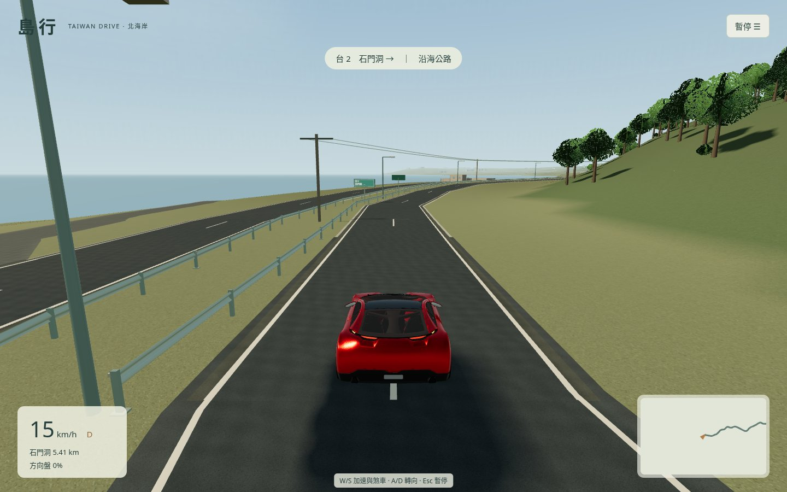
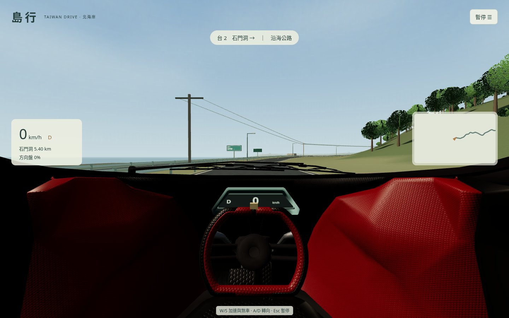
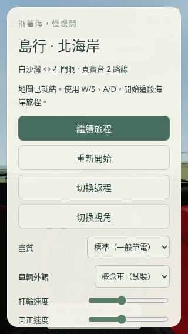

## 最終凍結連續片段

全新BrowserContext（cookies／origins空）、標準960×600、Chromium154／SwiftShader，真實W/S/A/D/Esc及普通菜單操作，唯讀snapshot追蹤器，無匯入／瞬移／Game寫入。轉向／回正透過真實range鍵盤操作為0.4，目標12m/s。

- 真實elapsed **398.441s**、實際累積行駛 **1177.866m**、沿路進度1176.733m。1200m目標前約23m處煞停至 **0m/s** 並暫停；刷新後位置／travel一致且保持暫停。此為首500m及過渡段的連續片段，**不是5.41km完整旅程**，`journey_completed=false`。
- 邊界碰撞 **0**、記錄錯誤 **0**；不是完整設施／建築剛體碰撞證明。全部src/public/dist與package-lock、index、Vite設定、實際driver共 **29檔** 前後SHA256一致；無熱更新。
- Game活動牆鐘398.334s、模擬110.400s、丟棄287.934s；保留全部 **564幀**，間隔中位683.4ms、p95 1033.3ms、最大11844.6ms（含啟動）。不同於上面的1280×800對照條件，不能拿來宣稱FPS提升。500m截圖非同步耗時2835.7ms，亦保留在原始觀察中。
- [完整JSON／所有原始幀與前後哈希](driving-comfort.json)，203,084 bytes，SHA256 `3b4ddf78a097c3facf897caa5053f01258a074db4861aad6cd06f0b4855af9f4`。逐項測試、最終25檔src/public/dist凍結清單及各候選／正式性能匯總見 [comfort-summary.json](comfort-summary.json)。

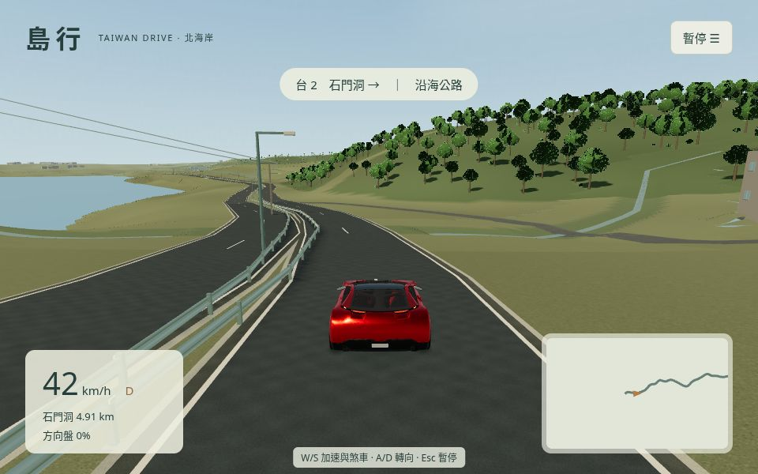
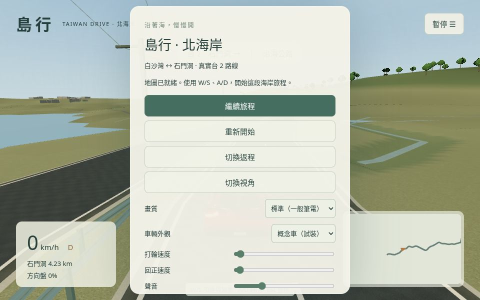

## 發布

雲端正常fast-forward推送`main`，發布的遊戲代碼為 **7ca50f17746a33d781039c8bf1b4fde8677fc8d0**。[GitHub Actions執行](https://github.com/HiWangHongpeng/taiwan-drive/actions/runs/39948265008) build／deploy／verify全部成功，Chrome for Testing156.0.8078.4／單worker／SwiftShader線上 **5項通過**，包含版本化GLB、world SHA256、無調試掛鉤、概念車就緒與真實W加速，以及音效／地圖／WebGL故障處理。來源、測試截圖與報告在GitHub，可直接查看；後續僅追加證據文件，不改已測src/public/dist。

[打開遊戲](https://hiwanghongpeng.github.io/taiwan-drive/)。這仍不能證明使用者普通筆電的FPS或卡頓已解除。新版本不沿用歷史整趟或舊版「基本順暢」回報作當前手感證據。

真實桌面GPU／人類手感、全新兩向完整5.41／5.43km、不同OS仍待驗證。環境材質為原創程序估算，沒有取得照片級山體、真實樹木或現場護欄資產；此次也沒有擴大網路權限。

## 尚未閉合的卡頓驗收

另以全新Chromium154、僅`--no-sandbox`（未指定SwiftShader／ANGLE）實際探測：`/dev/dri`不存在，WebGL2的UNMASKED_RENDERER為 `ANGLE (Google, Vulkan 1.3.0 (SwiftShader Device (Subzero) (0x0000C0DE)), SwiftShader driver)`。因此目前雲端沒有可用的硬體GPU驗收路徑，不是只依文件假設。原始探測已納入comfort-summary.json。

本輪已實作並發布接地、顯示插值與環境修整，但**卡頓仍不能算已確認解決**。下一步需要可用硬體GPU的受授權測試，或真人在公開版本的文字體感回報，才能定位剩餘瓶頸；不讀取／複製／上傳工作電腦的檔案或診斷存檔。維持原網路權限，沒有為了數字壓低像素、降低地形精度或過濾慢幀。
