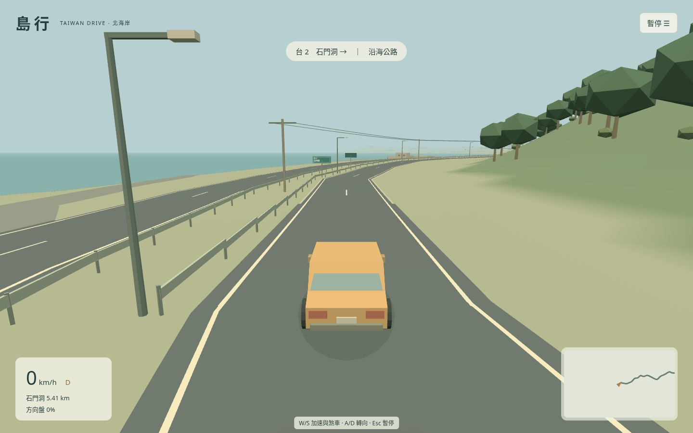
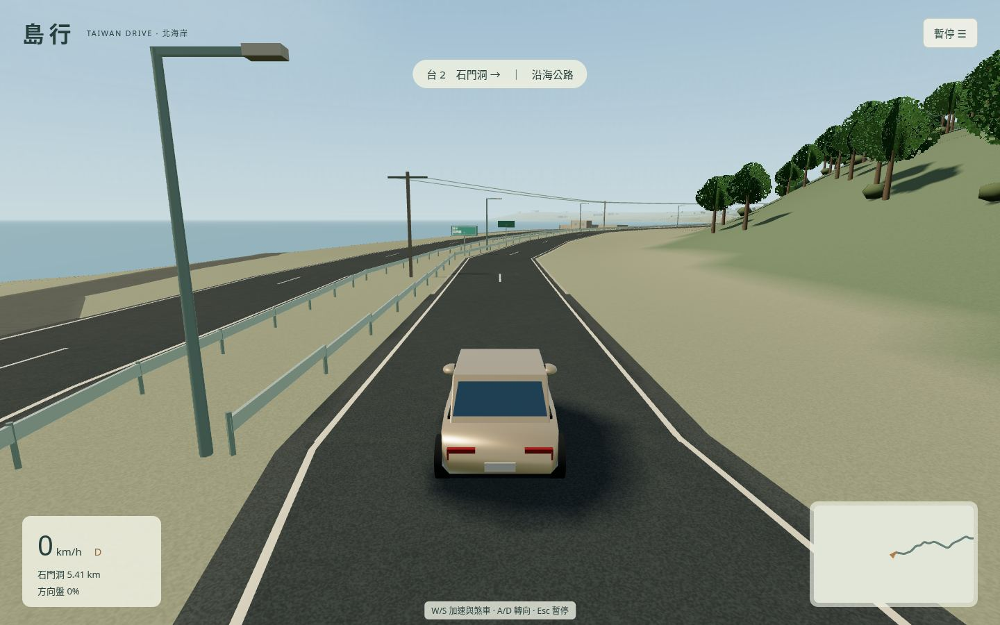
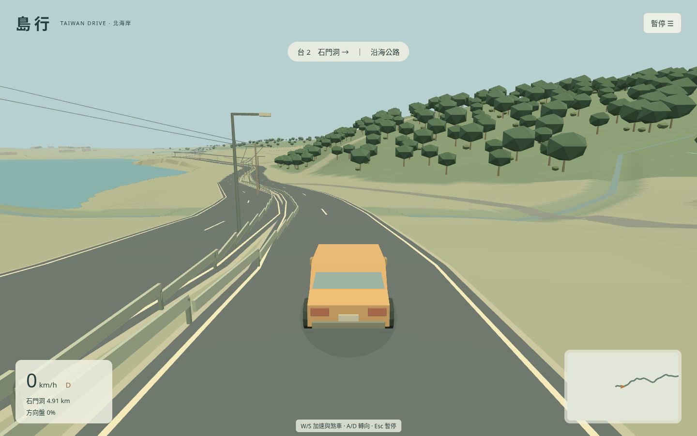
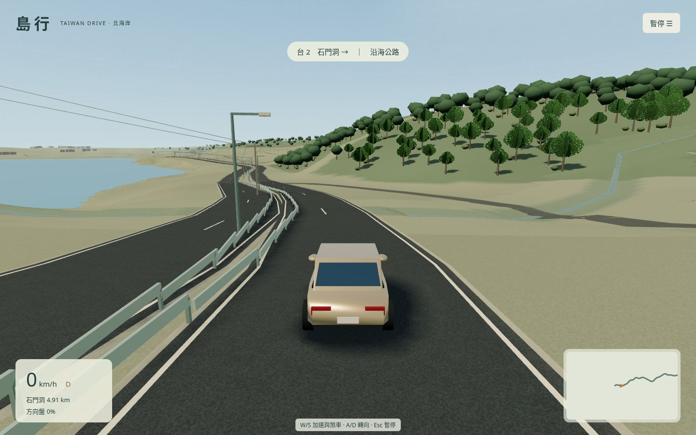
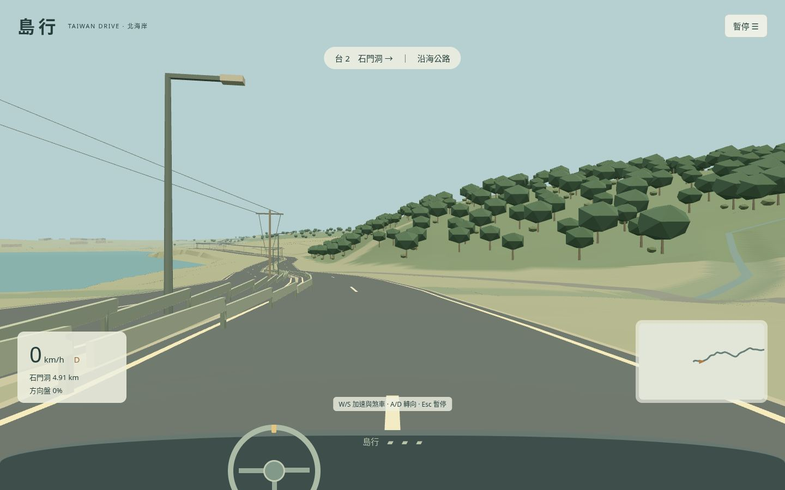
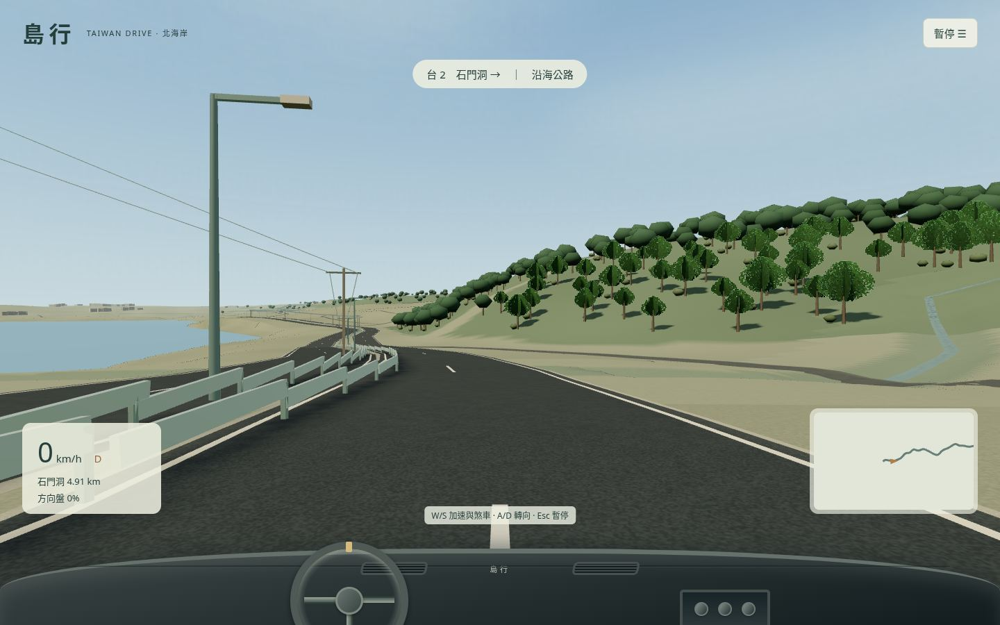

# 畫質改進：普通筆記本預算

歐卡是質感參考，並非本輪已達成的等級。其大型手工資產庫、照片級材質、完整3D駕駛艙、天氣與經過多年優化的渲染不能由本輪程序素材直接補齊。本輪先替換最影響觀感的純色表面與簡單輪廓，保留靜態前端和真實台2佈局。

## 可審查畫面

左為 `e7753d1`，右為本輪標準檔。1440×900、DPR1、同一OSM路線點、同一方向與視角。透過嚴格存檔匯入的檢查點截圖；不是連續駕駛證據。拍攝前等待至少3秒及18個實際渲染幀，讓相機收斂。

| 視角 | 舊版 | 新版標準檔 |
|---|---|---|
| 起點 |  |  |
| 約500m |  |  |
| 駕駛艙 |  |  |

## 實作與邊界

- 原創固定種子材質：瀝青顆粒、地表紋理、混凝土、牆面、天空薄雲、海面法線、葉片卡片與柔和接觸陰影。沒有使用照片轉紋理或下載外部模型，來源帳本已更新。
- 色調映射、天空與海霧層次；金屬、車漆、玻璃及海面使用預過濾天空反射。地表不採全場景昂貴反射。
- 原創重新建模的小轎車，分開輪軸、車窗、B柱、門縫、後視鏡、輪圈及燈具；剛性部分按材質合併。駕駛艙仍是簡化DOM儀表台，增加材質層次、出風口與旋鈕，並未宣稱完整3D內飾。
- 樹位和所有地塊排除條件保持不變。近處使用有鏤空輪廓的原創葉片卡片，遠處使用簡化樹冠；只在移動24m或改畫質時更新近遠分組，沒有逐幀掃全圖重新生成樹。每棵樹只屬於一個近遠分組。
- 建築窗台／分隔框、屋緣與候車棚背板／座椅支承是原創估算，不是現場設施測繪。原OSM輪廓、站點退讓及建築基座仍保留。

| 設定 | 省電 | 標準（預設） | 精細 |
|---|---|---|---|
| 像素比上限 | 1 | 1.5 | 2 |
| 近樹細節半徑 | 100m | 150m | 240m |
| 太陽陰影 | 關閉，保留車底接觸陰影 | 1024，近景靜態緩存 | 1536，含逐幀車影 |
| 地表凹凸／各向異性 | 關／1 | 關／2 | 開／8 |

畫質偏好使用獨立鍵 `island-drive:graphics:v1`，只接受三個已知字串；不更改v1駕駛存檔。標準檔不讓移動車體寫入緩存的靜態陰影，避免留下舊車影。降低動態偏好下海面動畫停止，原相機減少動態行為保留。

## 畫質預覽 af2081e 的驗證狀態

本輪 `npm test` 16項通過；`npm run build` strict TypeScript＋Vite通過（JS570.89kB／gzip152.80kB，保留500kB警告）；`npx playwright test` 單worker16項通過，360.061秒，無失敗／跳過／flaky。包含畫質設置獨立保存、非法偏好回退、近遠樹數量守恆、靜態陰影不逐幀重畫、材質切換資源數量有界、兩向檢查點，以及原有鍵盤、存檔、終點與320px／桌面布局回歸。正式子路徑實測載入、W鍵加速、無debug hook／腳本或資源錯誤。

實際查看起點、500m、駕駛艙、海岸朝向、候車棚和停車面／來源接路的檢查圖。前三組同機位圖片如上；附加側視按OSM地物方向取景，不是任意地點駕駛。地塊邊緣和溪流遠觀仍有簡化痕跡，並未達成完整實景精度。前三組新舊車輛狀態逐欄一致，拍攝期間各自src/public哈希不變。

性能條件：1280×800、DPR1、Chromium154／SwiftShader，起點暫停菜單、就緒後45秒，含全部初始化／慢幀。中位取中間兩數平均，p95為nearest rank。末幀的調用／三角形不是整段平均。

| 階段 | 原始幀數 | 幀間隔 中位／p95／最大 ms | 末幀調用／三角形 |
|---|---:|---:|---:|
| visual-before | 131 | 333.4 / 750.0 / 7283.0 | 360 / 576593 |
| visual-standard-initial | 20 | 2658.3 / 7499.7 / 7983.0 | 391 / 635970 |
| visual-standard | 57 | 816.6 / 1600.0 / 7583.0 | 391 / 635970 |
| visual-standard-final | 58 | 783.4 / 2233.3 / 7299.7 | 391 / 597348 |
| visual-low | 72 | 641.7 / 1200.0 / 7816.5 | 391 / 599012 |

第一個新增效果候選嚴重變慢，因此收緊為只對反光物件使用環境反射、普通檔停用地表凹凸並降低各向異性，靜態陰影改為VSM緩存；近處樹冠再改為原創葉片卡片。這改變了效果／算法預算，不能稱為完全同畫質提速。最終標準與省電仍比舊純色版慢，不能稱流暢；真實桌面GPU與人類手感未由這些軟渲染數字證明。沒有減小比較的窗口或像素比，也沒有過濾慢幀。完整原始幀、View.render牆鐘、renderer.info、實例數、場景生成時間、af2081e的src/public/dist哈希和檢查點來源見 [visual-summary.json](visual-summary.json)。早期候選無完整凍結源碼清單，只作診斷，不能冒充最終包性能。

### 預覽版完整去程（保留原始結果）

`af2081e` 的全新瀏覽器存檔，以真實W/S/A/D、Esc及普通選單點擊，從白沙灣連續到石門洞，停穩點擊完成。真實1147.003秒，路線進度5383.483m／5410.712m，實際行駛5387.186m，終速0.346m/s，64次道路邊界碰撞計數、0記錄錯誤。全部src/public/dist及實際driver前後hash相同。2423個原始幀全部保留，中位450ms、p95 800ms、最大7999.8ms；活動牆鐘1146.354s、模擬465.433s、丟棄680.921s。這不是流暢度或無碰撞通過證據。[完整原始JSON](driving-visual-outbound.json)。

碰撞計數集中在約510–552m；當時同步截圖會暫停測試端鍵盤回饋，可能放大持續轉向，沒有證據把所有接觸完全歸因於它。後續driver改為非同步截圖並記錄捕捉耗時，保留此趟，沒有修改遊戲物理或刪除慢幀。

### 最後修整與獨立設備回饋

著色器專項實測（初版觀測器先排除depth／blur前綴的干擾，再以未改動af2081e工作樹重現）：畫質切換後的穩定幀仍同時提交VSM及PCFSoft接收材質。修正切換時所有場景材質的重編譯標記；測試只攔截WebGL呼叫觀察實際shader，不讀寫Game狀態，不添加正式debug hook。修正版連續high→standard→high→standard四次切換的接收shader專項通過（35.5秒）。完整回歸與重新凍結去程結果另列，不把預覽版整趟當作位元相同的最終版。

2026-10-23（上海時間），使用者實際在普通筆記本／辦公電腦以預設標準檔回報「基本順暢」。這是該設備主觀體感，不是測量FPS，不能外推所有桌面GPU。真實GPU量化效能與長時間人類手感仍待驗證。

線上預覽的build與deploy成功；verify在瀏覽器安裝後跑過前3項，觸及10分鐘job上限而取消，剩餘2項並未驗證。已將verify總預算調為15分鐘，沒有放寬測試斷言或隱藏失敗；最終部署狀態另列。

已排除一項測試工具問題：新舊Vite開發服務共用node_modules快取，造成Outdated Optimize Dep 504；舊版對比改用獨立快取。正式構建不使用該依賴快取。也修正截圖腳本的就緒等待和相機收斂等待，失敗圖未當驗收圖。

## 仍有的差距

沒有照片級道路與建築資產、精細地貌岩壁、完整3D內飾和儀表、動態天氣／日夜或大量交通場景。未知地塊仍簡化，沒有為豐富畫面亂添建築或植被。遠樹切換與靜態陰影重定位仍可能可見，不等同歐卡的資產／LOD成熟度。普通筆記本真實GPU的速度與人類觀感需實機驗證，SwiftShader幀間隔不能換算成玩家FPS。
